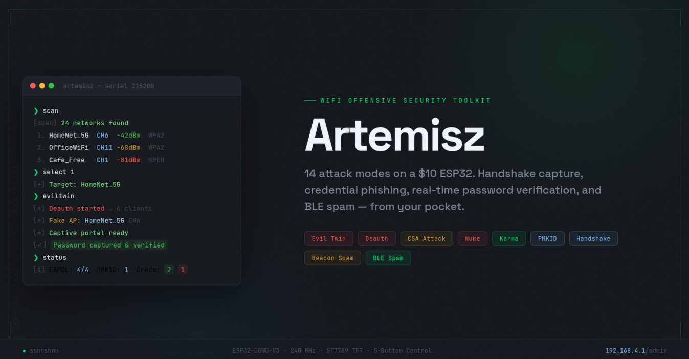
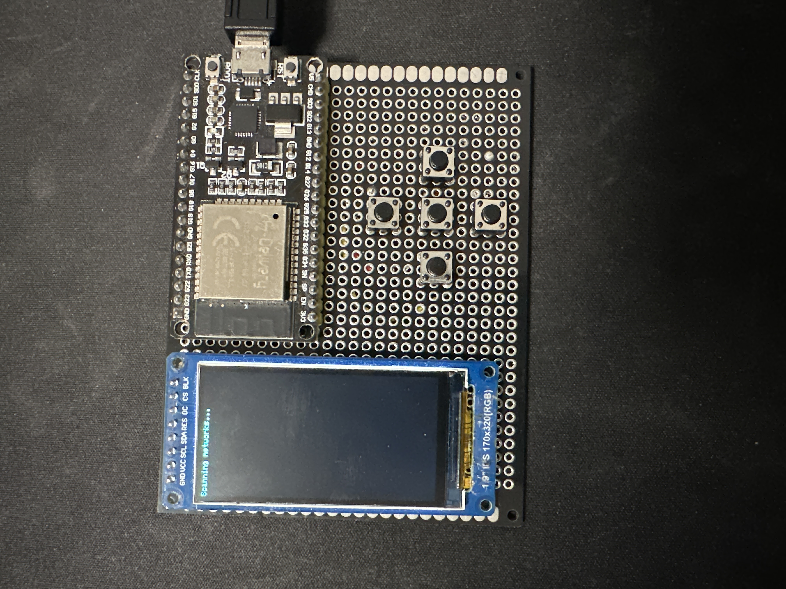
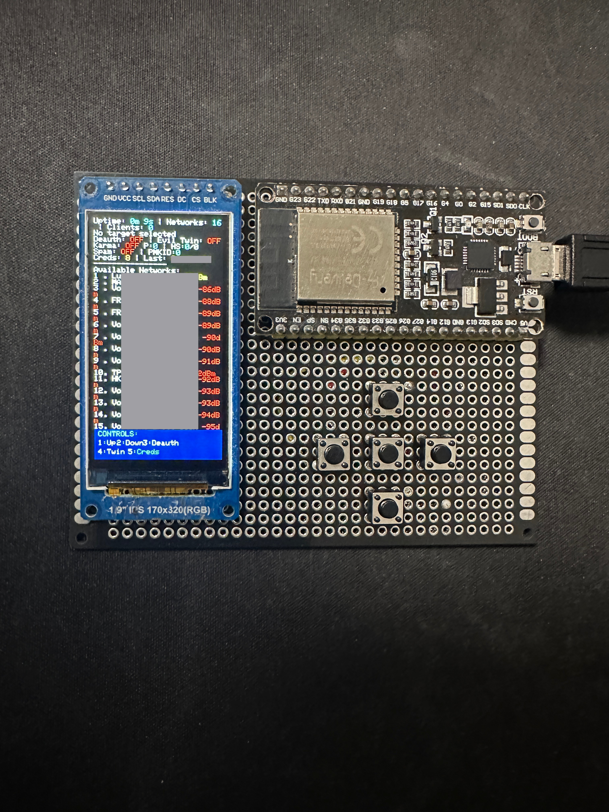
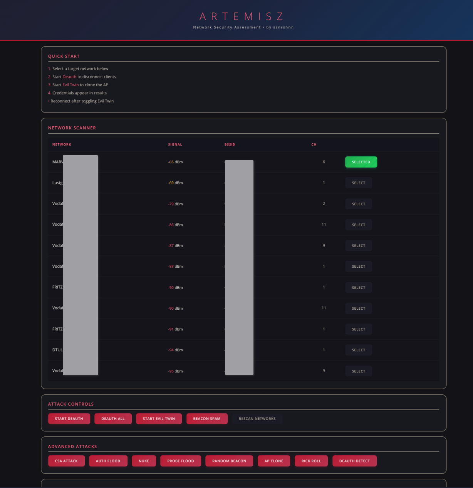
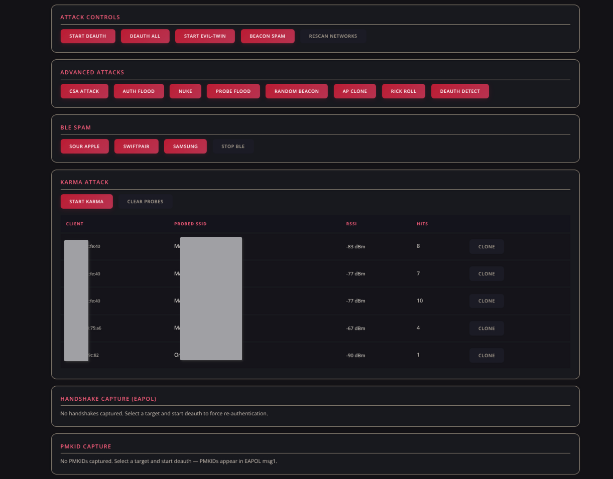
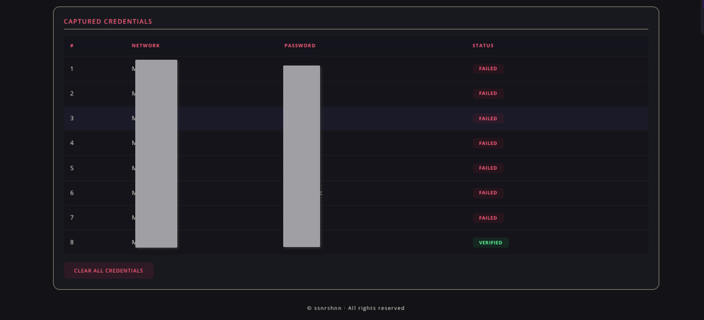
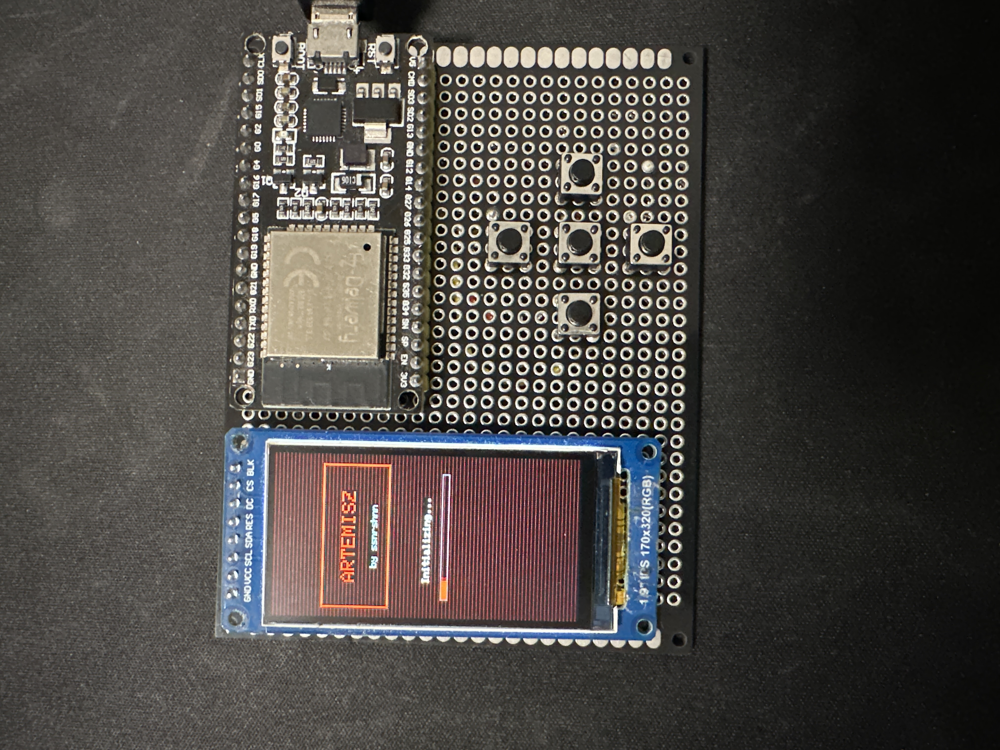
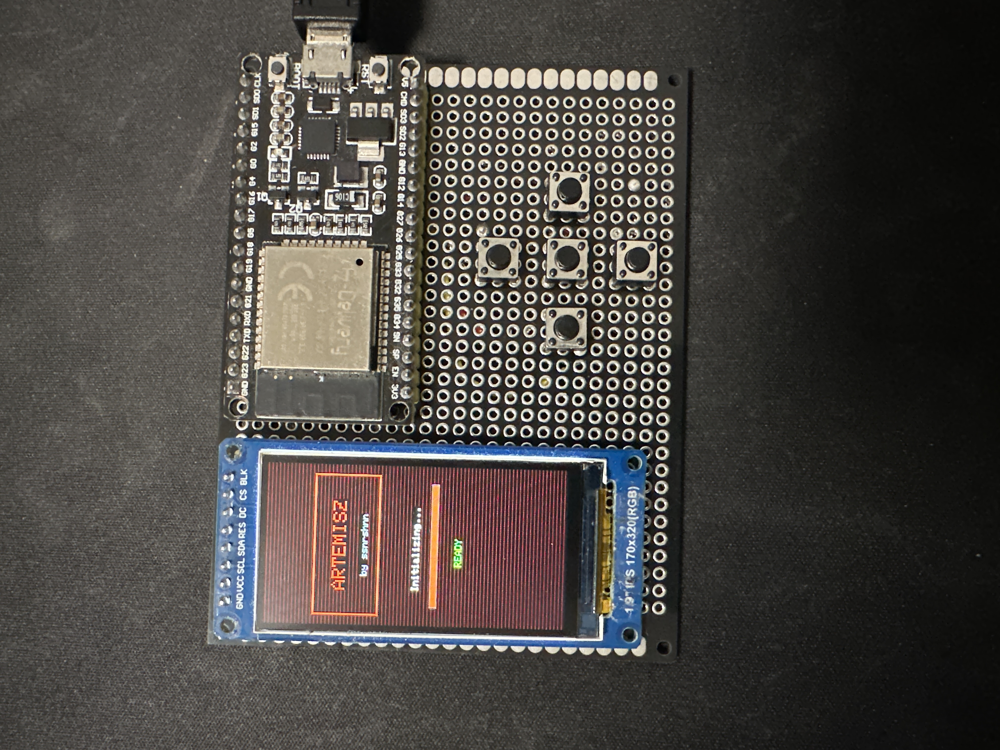
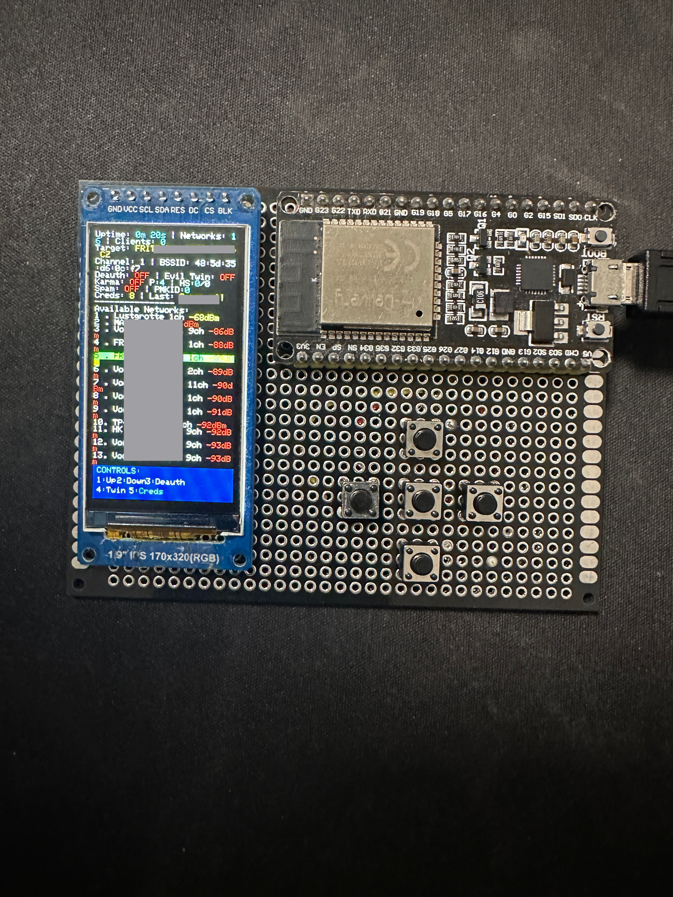
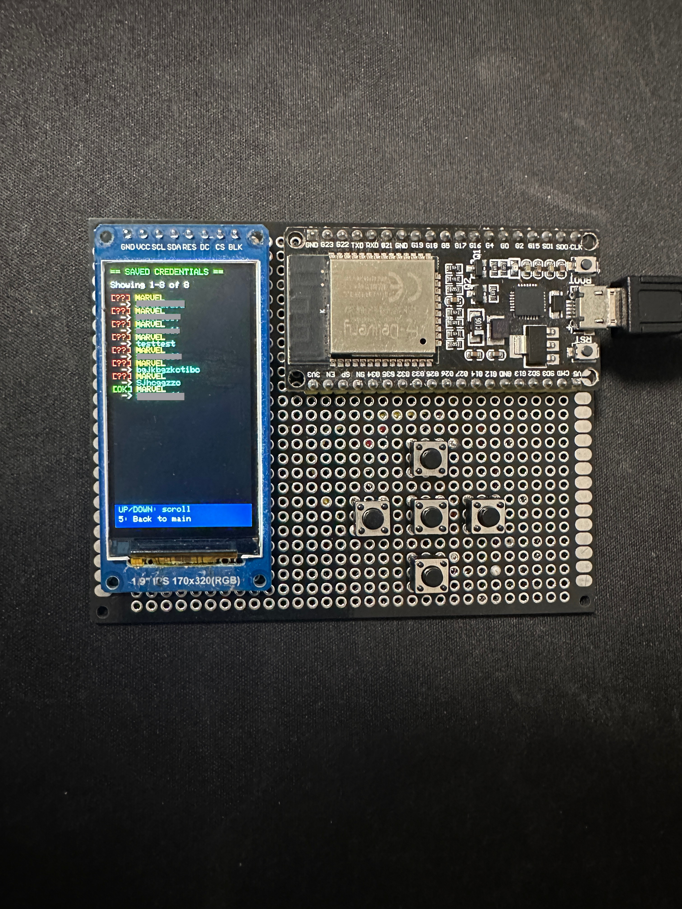

# Artemisz — ESP32 WiFi Offensive Security Toolkit

> A compact, all-in-one WiFi pentesting device built on an ESP32 with a TFT display and 5-button control.



Artemisz is custom ESP32 firmware that turns a ~$10 dev board into a portable WiFi security research tool. It packs **14 attack modes**, handshake/PMKID capture, credential phishing with real-time password verification, and BLE spam — all controllable via onboard buttons, a web admin panel, or serial CLI.

## Hardware

- **ESP32-D0WD-V3** (240 MHz, 320KB RAM, 4MB Flash)
- **1.9" TFT Display** (170×320, ST7789, SPI)
- **5 Tactile Buttons** — Up, Down, Deauth, Evil Twin, Creds

Total cost: under $15.

<p align="center">
  
  
</p>

## Attack Modes

| Mode | Description |
|------|-------------|
| **Deauth** | Targeted deauth/disassoc against a selected AP — per-client + broadcast bursts |
| **Deauth All** | Round-robin deauth across all visible networks |
| **Evil Twin** | Clones target SSID, serves a captive portal, phishes the WiFi password, verifies it against the real AP in real-time |
| **CSA Attack** | Injects forged Channel Switch Announcement beacons — bypasses WPA3/PMF |
| **Auth Flood** | Spoofs mass authentication requests to exhaust the AP's association table |
| **Nuke** | Deauth + CSA + Auth Flood combined |
| **Karma** | Sniffs probe requests, responds with matching beacons, can auto-clone into Evil Twin |
| **Beacon Spam** | Floods 30 fake SSIDs (e.g. "FBI Surveillance Van") |
| **Random Beacon** | Broadcasts randomly generated SSIDs |
| **AP Clone** | Floods cloned beacons of the target with varying BSSIDs |
| **Rick Roll** | Song lyrics as 16 beacon SSIDs |
| **Probe Flood** | Mass probe requests with spoofed MACs |
| **BLE Spam** | Sour Apple (iOS), Swiftpair (Windows), or Samsung Galaxy popup spam |
| **Deauth Detection** | Passive mode — counts deauth frames and alerts |

## Capture Capabilities

- **4-Way Handshake** — sniffs EAPOL messages, exports as PCAP or HCCAPX (Hashcat-ready)
- **PMKID** — extracts from EAPOL Message 1
- **Credentials** — stores up to 20 SSID/password pairs with verified/failed status, persisted to flash (NVS)

## Web Admin Panel

Accessible at `192.168.4.1/admin` after connecting to the Artemisz AP. Full control over scanning, attacks, captures, and credentials.

<p align="center">
  
</p>
<p align="center">
  
</p>
<p align="center">
  
</p>

## TFT Display

Live dashboard showing target info, attack status, captured credentials, color-coded RSSI, and button controls legend.

<p align="center">
  
  
  
</p>
<p align="center">
  
</p>

## Wiring

### Display (ST7789 SPI)

| Display Pin | ESP32 Pin | Description  |
|-------------|-----------|--------------|
| GND         | GND       | Ground       |
| VCC         | 3.3V      | Power        |
| SCL         | GPIO 18   | SPI Clock    |
| SDA         | GPIO 23   | SPI MOSI     |
| RES         | GPIO 4    | Reset        |
| DC          | GPIO 2    | Data/Command |
| CS          | GPIO 5    | Chip Select  |
| BLK         | GPIO 15   | Backlight    |

### Buttons

| Button | Function   | ESP32 Pin |
|--------|------------|-----------|
| 1      | Up         | GPIO 12   |
| 2      | Down       | GPIO 13   |
| 3      | Deauth     | GPIO 14   |
| 4      | Evil Twin  | GPIO 27   |
| 5      | Creds      | GPIO 33   |

All buttons connect to GND on the other side. Internal pull-ups are used.

## Installation (PlatformIO)

1. Install [PlatformIO](https://platformio.org/install)
2. Clone this repository
3. Open the project in PlatformIO
4. Build and upload:
   ```
   pio run -t upload
   ```
5. Open the serial monitor at 115200 baud:
   ```
   pio device monitor
   ```

> **Note:** This project requires `espressif32@6.7.0` (Arduino Core 2.0.x / ESP-IDF 4.4). Arduino Core 3.x (ESP-IDF 5.x) blocks raw management frame injection. The pinned platform version in `platformio.ini` handles this automatically.

## Development & Tests

The protocol-parsing and export logic (802.11 frame decoding, EAPOL 4-way
handshake classification, PMKID extraction, PCAP/HCCAPX serialization) lives in
a hardware-independent library at [`lib/artemisz_core/`](lib/artemisz_core) and
is covered by host-side unit tests — no ESP32 needed:

```
make test
```

See [TESTING.md](TESTING.md) for details. CI builds the firmware and runs the
test suite on every push.

## Serial CLI

Connect at 115200 baud and type `help`. Available commands:

`scan` · `select` · `deauth` · `deauthall` · `eviltwin` · `karma` · `nuke` · `csa` · `authflood` · `beacon` · `randombeacon` · `apclone` · `rickroll` · `probeflood` · `blespam` · `sigmon` · `status` · `creds` · `pmkid` · `handshake` · `help`

## Portable Power

| Power Source | Voltage | Connect To | Runtime | Notes |
|---|---|---|---|---|
| USB power bank | 5V | USB port | 4–10 hours | **Recommended** |
| 4× AA batteries | 6V | VIN + GND | 3–6 hours | Good current capacity |
| 9V battery | 9V | VIN + GND | 30–90 min | Short runtime, runs hot |

> Do not connect a battery and USB at the same time. Peak draw is ~200–300 mA.

## Disclaimer

This tool is for **authorized security research and educational purposes only**. Unauthorized access to computer networks is illegal. Always get written permission before testing.

---

*Built by ssnrshnn*

### Display Information

The display shows:
- Current uptime and number of detected networks
- Selected target network with channel and BSSID
- Attack status (deauth and evil twin)
- Available WiFi networks with channels
- Captured passwords (when available)
- Button control reference

## How It Works

1. **Network Scanning**: The device scans for nearby WiFi networks every 15 seconds
2. **Target Selection**: Use Button 1 to select a target network
3. **Deauthentication Attack**: Button 2 sends deauthentication packets to disconnect clients from the target network
4. **Evil Twin Attack**: Button 3 creates a fake access point mimicking the target network
5. **Password Capture**: When a user connects to the evil twin and enters their password, it's captured and displayed

## CREDITS

* [M1z23R](https://github.com/M1z23R) --> MODIFIED VERSION OF HIS SCRIPT
* [Spacehuhn Technologies](https://github.com/SpacehuhnTech) --> TEMPLATE

